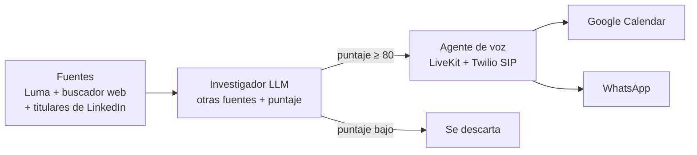

# 🏃 Chasqui

> Los **chasquis** eran los mensajeros del Imperio Inca: corrían por el Qhapaq Ñan
> llevando solo las noticias importantes. Este Chasqui hace lo mismo con los eventos tech de Lima.

**Qué hace:** busca eventos tech en Lima, investiga cada uno, y **solo si es realmente
imperdible para ti**:

1. 📞 **te llama** al celular (agente de voz con LiveKit) y te cuenta por qué ir,
2. 📅 si le dices que sí, **lo agenda en tu Google Calendar**,
3. 💬 te deja **un WhatsApp** con nombre, fecha, lugar, link y el porqué.



### Cómo se respeta LinkedIn
Chasqui **no entra a LinkedIn** ni automatiza nada ahí. Le pide a un **buscador web**
(la herramienta `web_search` de OpenAI) los eventos de `linkedin.com/events` en Lima y se queda
solo con el **titular** que aparece en los resultados. Después el investigador confirma
fecha, lugar y de qué trata en **otras fuentes** (web oficial, Meetup, Eventbrite, Luma, comunidades).

---

## ✋ Lo que SÍ o SÍ tienes que hacer tú (≈30 min, una sola vez)

Son cuentas y permisos que solo tú puedes crear. Todo lo demás ya está automatizado.

### 1. Clonar e instalar
```bash
git clone https://github.com/Deyvydt/chasqui.git && cd chasqui
python -m venv .venv && source .venv/bin/activate   # Windows: .venv\Scripts\activate
pip install -r requirements.txt
python -m chasqui.agent download-files   # descarga los modelos locales (VAD)
```
Copia el `.env` que te pasé a la raíz del proyecto (ya trae tu número).
Si no lo tienes: `cp .env.example .env` y pon `MI_TELEFONO=+51...`.

### 2. OpenAI (buscar e investigar eventos)
- Crea una API key en <https://platform.openai.com/api-keys> (necesita saldo).
- Ponla en `OPENAI_API_KEY`.

### 3. LiveKit Cloud (la voz)
- Puedes usar tu proyecto **DiloAI** o crear uno nuevo en <https://cloud.livekit.io>.
- **Settings → API Keys**: copia `LIVEKIT_URL`, `LIVEKIT_API_KEY`, `LIVEKIT_API_SECRET`.
- La voz (STT, LLM y TTS) usa **LiveKit Inference**, así que no necesitas más keys.

### 4. Twilio (llamada + WhatsApp)
- Crea una cuenta en <https://www.twilio.com> y **verifica tu celular** (+51...) al registrarte.
- Copia `TWILIO_ACCOUNT_SID` y `TWILIO_AUTH_TOKEN` (están en la portada de la consola).
- **Permite llamar a Perú:** Console → Voice → Settings → **Geo permissions** → marca **Peru**.
  Si usas trunk SIP, revisa también *Elastic SIP Trunking → Settings → Geo permissions*.
- **WhatsApp sandbox:** Console → Messaging → *Try it out* → *Send a WhatsApp message*.
  Desde tu WhatsApp manda el mensaje `join <tus-dos-palabras>` al **+1 415 523 8886**.
  Esto abre una ventana de 24 h; si pasa más tiempo, vuelve a mandar el `join`.

Luego corre esto y **el script configura toda la telefonía solo** (trunk SIP, credenciales,
número, troncal de LiveKit y te escribe `SIP_OUTBOUND_TRUNK_ID` en el `.env`):
```bash
python scripts/configurar_telefonia.py
```

> En cuenta **trial**: Twilio solo llama a números verificados y antes de conectar te dice
> un mensaje de prueba ("press any key"): presiona una tecla y entra Chasqui.
> Si Twilio no te deja usar SIP Trunking en trial, súbela a cuenta pagada (unos 20 USD de saldo).

### 5. Google Calendar (cuenta de servicio, sin login cada vez)
1. <https://console.cloud.google.com> → crea un proyecto → **APIs & Services → Library** → activa **Google Calendar API**.
2. **IAM & Admin → Service Accounts → Create** → entra a la cuenta → **Keys → Add key → JSON**.
3. Guarda el JSON como `credenciales/google-sa.json`.
4. En Google Calendar → **Configuración de tu calendario → Compartir con personas específicas** →
   agrega el correo de la cuenta de servicio (termina en `iam.gserviceaccount.com`) con
   **"Hacer cambios en eventos"**.
5. Pon tu correo de Gmail en `GOOGLE_CALENDAR_ID`.

### 6. Revisar que todo esté OK
```bash
python scripts/revisar_config.py
python -m chasqui probar-whatsapp       # te llega un WhatsApp de prueba
python -m chasqui probar-calendario     # aparece un evento [PRUEBA] mañana
```

---

## 🚀 La demo

**Terminal 1**: levanta el agente de voz (déjalo corriendo):
```bash
python -m chasqui.agent dev
```

**Terminal 2**: busca, investiga y llama:
```bash
python -m chasqui correr --forzar
```

En 1-3 minutos busca e investiga los eventos, te muestra la tabla con puntajes y **te llama**.
Contesta, conversa con Chasqui y dile "sí, agéndalo". Al final te llega el WhatsApp.

- Sin `--forzar` solo te llama si hay algo con puntaje ≥ `UMBRAL_IMPORTANCIA` (80), que es el uso real.
- Con `--forzar`, si no hay nada imperdible, te llama con el mejor que encontró y te dice que es una prueba.
- Nunca te llama dos veces por el mismo evento (`data/notificados.json`).

### Comandos
| Comando | Qué hace |
|---|---|
| `python -m chasqui buscar` | Recolecta, investiga y puntúa (no llama) |
| `python -m chasqui ver` | Muestra la última tabla de eventos |
| `python -m chasqui llamar [--forzar]` | Te llama con lo imperdible ya evaluado |
| `python -m chasqui correr [--forzar]` | `buscar` + `llamar` (lo que correría el cron) |
| `python -m pytest` | Tests offline |

### Personalizar
- **`perfil.md`**: tu perfil; el investigador lo usa para decidir qué te conviene. Edítalo cuando cambien tus intereses.
- **`.env`**: `UMBRAL_IMPORTANCIA`, `MAX_EVENTOS_POR_LLAMADA`, `DIAS_ADELANTE`, voz (`TTS_VOZ`), modelos.

---

## 📁 Estructura
```
chasqui/
├── chasqui/
│   ├── __main__.py      # CLI (buscar, llamar, correr, probar-*)
│   ├── agent.py         # agente de voz LiveKit: llama, conversa, usa tools
│   ├── fuentes/         # luma.py (API pública) y buscador.py (web + titulares LinkedIn)
│   ├── evaluador.py     # investiga en otras fuentes y pone puntaje 0-100
│   ├── estado.py        # selección de imperdibles + no repetir avisos
│   ├── llamada.py       # despacha al agente (Agent Dispatch)
│   ├── whatsapp.py      # Twilio WhatsApp (sandbox o plantilla)
│   ├── calendario.py    # Google Calendar (cuenta de servicio)
│   └── modelos.py       # Evento + fechas en español
├── scripts/
│   ├── configurar_telefonia.py    # Twilio SIP trunk + LiveKit outbound trunk
│   ├── crear_plantilla_whatsapp.py # plantilla para producción (aprobación Meta)
│   └── revisar_config.py
├── perfil.md
└── tests/
```

## 🔜 Siguientes pasos (después de la demo)
- **Automático todos los días:** desplegar el agente en LiveKit Cloud (`lk agent create`) y
  programar `python -m chasqui correr` con cron o GitHub Actions (por ejemplo a las 8 a. m.).
- **WhatsApp de producción:** número propio en Twilio + `python scripts/crear_plantilla_whatsapp.py`
  (WhatsApp exige plantilla aprobada cuando la empresa escribe primero).

---

## 📖 Glosario (qué significa cada sigla)
| Término | Significa | Para qué sirve aquí |
|---|---|---|
| **SIP** | *Session Initiation Protocol*, protocolo de inicio de sesión | Conecta internet con la red telefónica para llamar a tu celular |
| **Trunk (troncal)** | Una "línea" virtual entre dos sistemas | Twilio ↔ LiveKit |
| **STT** | *Speech-To-Text*, voz a texto | Entiende lo que dices |
| **TTS** | *Text-To-Speech*, texto a voz | La voz de Chasqui |
| **LLM** | *Large Language Model*, modelo de lenguaje grande | Piensa, investiga y conversa |
| **VAD** | *Voice Activity Detection*, detección de actividad de voz | Sabe cuándo hablas y cuándo te callas |
| **Dispatch** | "Despachar", enviar | Mandar al agente a una sala para que te llame |
| **Sandbox** | "Caja de arena", entorno de pruebas | WhatsApp sin aprobación de Meta |
| **Service account** | Cuenta de servicio, una cuenta para programas | Escribe en tu Calendar sin pedir login |
| **Cron** | Del griego *chronos*, tiempo | Ejecutar tareas a una hora fija |
| **E.164** | Estándar internacional de números | Formato `+51...` |
